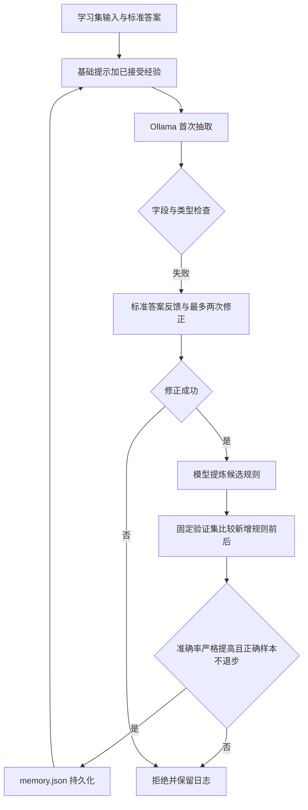

# 设计与验证说明

本项目选择作业二方案 b，自建简单 RSL 原型。RSL 在此实现为递归错误修正和跨样本外部经验更新；模型权重不变，不属于强化学习训练或参数微调。

## 数据流

`rsl.py` 包含 HTTP 客户端、字段检查、提示构造、学习编排和评测。`chat` 读取已保存规则进行抽取，不保存聊天反馈或更新经验；`learn` 依靠带标准答案的学习集形成经验；`evaluate` 冻结规则，测试答案只计分。

## 验证方法

检查五个字段完全匹配，预算要求数值或 null，排除 bool。候选规则须通过验证集筛选：完全正确率严格提高，且原来正确的样本没有变错。90 条学习、30 条验证、30 条测试使用不同模板生成，实体有重叠，属于教学合成数据，泛化覆盖有限。测试集不参与规则筛选。

三轮处理 270 次样本，首次失败 56 次，修正成功 2 次，候选规则 2 条，接受 1 条。验证集 28/30 提升为 29/30。独立测试基础提示和经验提示均为 30/30，不能据此证明泛化提升。接受的预算数值规则重复了基础提示中的要求，体现约束强化，未证明学习到全新概念。

详细逐例证据见 `results/learning/history.json`、候选规则验证文件和 `results/evaluation.json`。平均耗时是单次本地实验，受硬件、服务负载和版本影响。

## 边界与改进

标准答案是外部监督，模型并非仅靠自己判断正确性。重复使用验证集会过拟合；模板少且实体重叠限制结论。候选规则只做长度和字面重复检查，不做语义冲突检测。保存非原子写入，没有断点恢复；learn 从空规则重新开始并覆盖日志。后续可增加独立自然表达数据、人工标注反馈和规则淘汰机制；如课程要求权重更新，需要另加训练流程。
